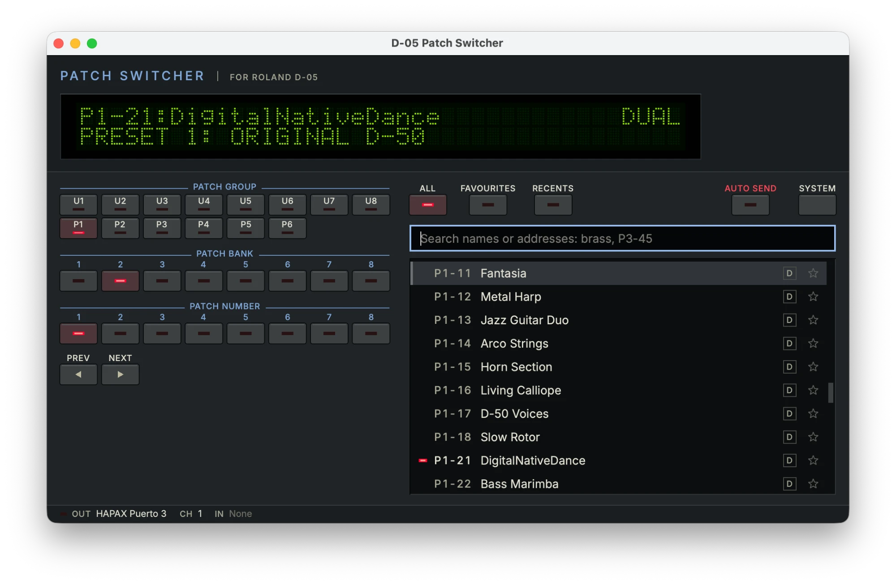

# D-05 Patch Switcher

Find and select patches on a Roland Boutique D-05 from your computer, over MIDI.

The D-05 keeps 896 patches behind an 8 × 8 button grid and a two-line display, with no
search. This app gives you one: type a few letters of a name, press Enter, and the synth
switches. Browse by group and bank with a grid that mirrors the panel, star favourites,
and see what you used recently, all on a black panel with a green display that looks
like it belongs next to the synth.

<p align="center">
  
</p>

**Status: pre-release ([v0.9.0](https://github.com/MarcAstr0/d05-patch-switcher/releases/tag/v0.9.0)).** See `docs/PLAN.md` for where it stands.

## What you need

- A Roland Boutique D-05 reachable from your computer over MIDI, directly (its own USB
  port) or through another device that forwards MIDI.
- Through a Squarp Hapax (the author's setup): the Hapax's USB port shows up as 16
  virtual ports. Pick one in Settings and try them in turn; the author's unit answers on
  port 3. The app's channel setting does not matter on this path, because the Hapax track
  rewrites it to its own output channel. `Prog.C` must still be ON at the D-05.
- On the D-05, in `FUNCTION` → `SYSTEM` → `MIDI`: `Prog.C` **ON** and `CH` set to the
  channel you pick in the app (if your firmware also shows `Bank.S`, turn it on). With
  `Prog.C` off the synth ignores the app in silence.
- Linux, macOS 12 or later, or Windows 10 or later.

## Install

Builds for the three platforms are attached to each GitHub release.

| Platform | File | Notes |
|---|---|---|
| Linux x86_64 | `d05-patch-switcher-x86_64.AppImage` | `chmod +x`, run |
| macOS (Intel and Apple Silicon) | `d05-patch-switcher-macos-universal.dmg` | Not notarised: see [Opening the macOS app](#opening-the-macos-app) |
| Windows x64 | `d05-patch-switcher-windows-x64.zip` | unzip anywhere, run the `.exe`. The exe is unsigned: SmartScreen may warn; click *More info*, then *Run anyway* |

### macOS notes

Needs macOS 12 or later. Open the `.dmg` and drag *D-05 Patch Switcher* onto the
*Applications* shortcut in the same window.

The app is signed ad hoc but not notarised by Apple, so Gatekeeper blocks the first
launch. Pick the steps for your macOS version.

#### Opening the macOS app

**macOS 12 to 14**

1. In Finder, open *Applications*.
2. Right-click (or Control-click) *D-05 Patch Switcher* and choose *Open*.
3. In the dialog, click *Open*. Later launches work normally.

**macOS 15 (Sequoia) and later** removed the right-click bypass for unnotarised apps.

1. Open the app once (double-click) and dismiss the warning with *Done*.
2. Open *System Settings* → *Privacy & Security* and scroll down to *Security*.
3. Next to "D-05 Patch Switcher was blocked", click *Open Anyway*, then confirm with
   your password or Touch ID and click *Open Anyway* again. Later launches work normally.

**Terminal alternative** (any version):

```sh
xattr -dr com.apple.quarantine "/Applications/D-05 Patch Switcher.app"
```

This removes the quarantine flag macOS attached to the download, so Gatekeeper no longer
stops the app.

#### MIDI on macOS

- A Hapax (or any class-compliant USB MIDI interface) needs no driver on macOS.
- The D-05's own USB port does need Roland's USB driver on macOS. Connecting through
  another device's MIDI output avoids that.
- Names, favourites, recents and settings live in
  `~/Library/Application Support/marcastr0/d05-patch-switcher/`.

## Use

1. Open Settings (`Ctrl+,`, `Cmd+,` on macOS), pick the MIDI output port your D-05 is behind, set the
   channel, press *Test*. The D-05's display should jump to the patch shown in the app.
2. Type in the search box: `brass`, `e-piano`, `p3-45`, `345`, `u2`. Arrow keys move,
   Enter sends. `PgUp` / `PgDn` step through the catalogue.
3. `Ctrl+D` toggles the favourite of the highlighted row; `Ctrl+2` shows favourites, `Ctrl+3` recents.
4. `F1` lists every shortcut.

User banks U1–U8 show their address until you name them (`F2`). Names, favourites and
recents live in `library.json`, and the settings in `settings.ini`, both in your user data
directory:

| Platform | Directory |
|---|---|
| Linux | `~/.local/share/marcastr0/d05-patch-switcher/` |
| macOS | `~/Library/Application Support/marcastr0/d05-patch-switcher/` |
| Windows | `%APPDATA%\marcastr0\d05-patch-switcher\` |

If a `logo.png` is placed in that directory it is shown in the panel instead of the
wordmark. `--config-dir DIR` points the app at another directory.

## Build from source

Requires CMake 3.22+, a C++17 compiler and Qt 6.4+ (Widgets). RtMidi is fetched at
configure time.

```sh
# Ubuntu/Debian: sudo apt install cmake g++ qt6-base-dev libasound2-dev
# macOS:         brew install cmake qt
# Windows:       Qt 6 (MSVC 2022) from the Qt installer or aqtinstall, CMake, VS 2022
cmake -S . -B build -DCMAKE_BUILD_TYPE=Release
cmake --build build -j
ctest --test-dir build --output-on-failure
./build/d05-patch-switcher
```

Command-line options (`--help`): `--list-ports`, `--port`, `--in-port`, `--channel`,
`--send P1-11` for scripting (exit 0 sent, 1 bad address, 2 port not found, 3 MIDI
error), `--fake-midi` for trying it with no hardware, `--config-dir`.

### Developer: testing MIDI without hardware

Unit tests run on a fake backend (`ctest`). On Linux, `scripts/midi-smoke.sh` drives the
real RtMidi backend against the ALSA `Midi Through` port and checks the bytes with
`aseqdump` (`sudo apt install alsa-utils`):

```sh
scripts/midi-smoke.sh [path/to/d05-patch-switcher]   # default: build/d05-patch-switcher
```

### Developer: CI and packaging

`.github/workflows/build.yml` builds, tests, packages and verifies on Linux, macOS and
Windows. Qt, linuxdeploy, its Qt plugin and every action are pinned to exact versions
(actions by commit SHA); bump a version and its sha256 together. Each package step is
followed by a step that runs the packaged binary (`--version`, `--list-ports`) and
checks the 2 MB binary limit. Packages are downloadable from each run's Artifacts.

## Trademarks

Roland, Boutique, D-05 and D-50 are trademarks of Roland Corporation. This project is
not affiliated with or endorsed by Roland, and ships none of its artwork. The patch
names in `data/` are reproduced from Roland's published Parameter Guide for
interoperability.

## Licence

MIT. See `LICENSE`. Third-party components (Qt under the LGPLv3, RtMidi, the Inter
typeface) and how to replace Qt are in `THIRD-PARTY-NOTICES.md`, which ships in every
package.
